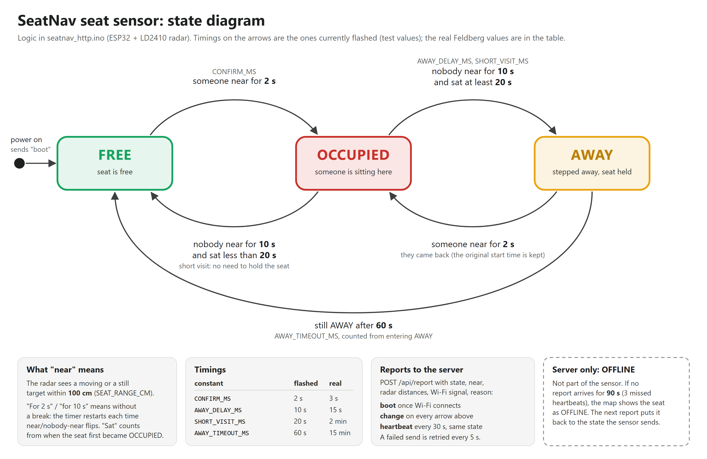
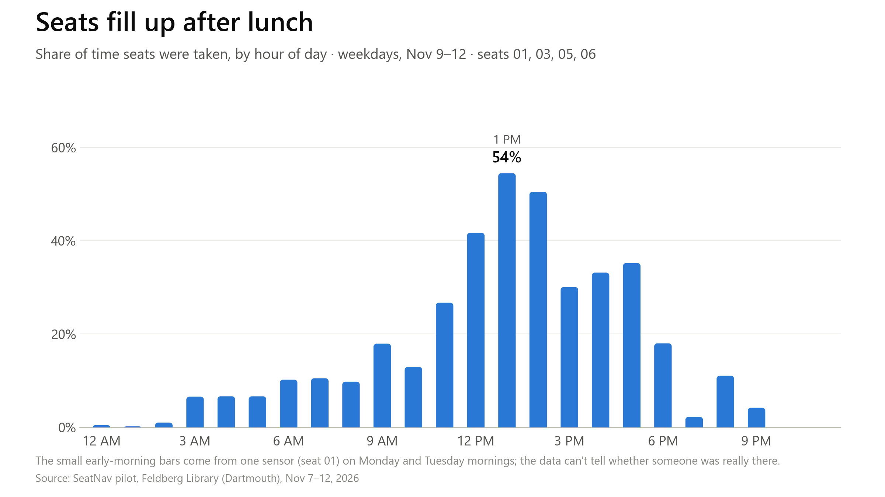

# SeatNav

A live map of free study seats at Dartmouth (ENGS 21, Team 28).

Each seat has a small radar sensor that tells a server whether someone is sitting there. Students open a web page and see a 3D map of the floor, with every seat coloured free, occupied or "stepped away". The first live floor is the Feldberg ground floor, with six sensored seats (`seat-01` to `seat-06`).

**Live:** https://seatnav.onrender.com (add `?demo` for made-up data)

## How it works

```
ESP32 + LD2410 radar  --POST /api/report every 30 s-->  FastAPI + SQLite on Render  --REST + WebSocket-->  3D web map
  seatnav_http.ino                                         main.py, store.py                                static/
```

1. **Sensor** (`seatnav_http.ino`): an ESP32 reads a 24 GHz LD2410 radar mounted at the seat. It decides whether the seat is FREE, OCCUPIED or AWAY, and reports every change, plus a heartbeat every 30 s, over Wi-Fi.
2. **Server** (`main.py`, `store.py`): a FastAPI app on Render keeps each seat's latest state and its history. It marks a seat OFFLINE if it hears nothing for 90 s, and pushes changes to open maps over a WebSocket.
3. **Map** (`static/`): plain HTML/JS with three.js. It draws the floor from a layout file and colours each seat live.

## Sensor logic



Someone counts as **near** when the radar sees a moving or still target within 100 cm of the sensor.

| Transition | When |
|---|---|
| FREE → OCCUPIED | someone near, without a break, for `CONFIRM_MS` (filters out people walking past) |
| OCCUPIED → AWAY | nobody near for `AWAY_DELAY_MS`, after sitting at least `SHORT_VISIT_MS` |
| OCCUPIED → FREE | nobody near for `AWAY_DELAY_MS`, after a short visit (less than `SHORT_VISIT_MS`) |
| AWAY → OCCUPIED | someone near for `CONFIRM_MS` again (they came back) |
| AWAY → FREE | still away after `AWAY_TIMEOUT_MS` |

| Constant | Test (flashed now) | Real (for Feldberg) |
|---|---|---|
| `CONFIRM_MS` | 2 s | 3 s |
| `AWAY_DELAY_MS` | 10 s | 15 s |
| `SHORT_VISIT_MS` | 20 s | 2 min |
| `AWAY_TIMEOUT_MS` | 60 s | 15 min |

OFFLINE is decided by the server, not the sensor: no report for 90 s means the seat shows as offline.

## API

| Endpoint | What it gives |
|---|---|
| `POST /api/report` | sensors report here (needs the `X-Device-Key` header) |
| `GET /api/seats` | every seat's current state and a summary |
| `GET /api/seats/{id}/history?hours=24` | state changes for one seat |
| `GET /api/seats/{id}/usage?hours=24` | percent of time free / occupied / away |
| `GET /api/log` | every raw report and event, in pages; used by the data collector |
| `GET /api/export/reports.csv`, `/api/export/events.csv` | the same data as CSV (`?hours=72`) |
| `WS /ws` | live updates |
| `GET /docs` | interactive API docs |

## Collecting data for graphs

Render's free tier wipes its disk on every restart, so `tools/collector.py` keeps a copy on a laptop. It pulls new rows every 20 s into `data/collected.db`, catches up after sleep or Wi-Fi drops, and exports CSVs:

```
tools\start-collector.cmd            double-click: start collecting in the background
python tools/collector.py status     is it working?
python tools/collector.py export     CSVs in data/export/ (timelines, hourly % taken, raw reports)
```

Step-by-step instructions are in [DATA_COLLECTION.txt](DATA_COLLECTION.txt).

## Pilot results (Feldberg, Nov 7–12, 2026)

Six sensors ran for 5.3 days with 96.8% uptime. Weekday seat use peaked at 1–2 PM. In the same block of carrels, one seat was used 4× as much as another. Two sensors gave false readings at night, and the data made that easy to spot.



All charts and numbers are in [docs/pitch/](docs/pitch/). They're made by `python tools/pitch_charts.py` from the collector's export.

## Run it locally

```
pip install -r requirements.txt
uvicorn main:app --port 8000
```

Open http://localhost:8000, or http://localhost:8000/?place=test for the one-desk test bench. Fake a sensor report:

```
curl -X POST localhost:8000/api/report -H "X-Device-Key: dev-key-change-me" -H "Content-Type: application/json" -d '{"seat":"test-01","state":"OCCUPIED"}'
```

Settings: `DEVICE_KEYS` (comma-separated sensor keys) and `DB_PATH` (default `seatnav.db`).

## Repo layout

| Path | What's there |
|---|---|
| `seatnav_http.ino` | sensor firmware (ESP32 + LD2410; needs the MyLD2410 library and a `secrets.h` with `SECRET_KEY`) |
| `main.py`, `store.py` | the backend |
| `static/` | the 3D map; `layout/*.json` describes each floor |
| `tools/` | the data collector |
| `docs/` | the state diagram (`.png`, plus an editable `.svg`) |
| `seatnav-app/` | an earlier Expo prototype, no longer used |
| `HANDOVER.md` | detailed notes for whoever works on this next |

## License

See [LICENSE](LICENSE).
